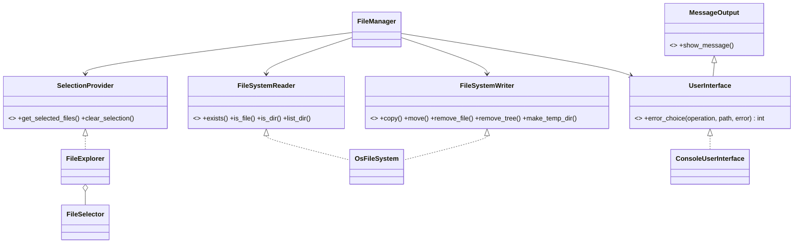

# Ateliers 1 et 2 - Testabilité et tests de `FileManager`

Gestionnaire de fichiers en console (`fmgr.py`) refactorisé pour rendre `FileManager` testable (atelier 1),
puis couvert par des tests unitaires, de couverture et de mutation (atelier 2).

## Équipe

- Emma Gailledrat ([@EmmaDotCom](https://github.com/EmmaDotCom))
- Kilian Carasco ([@Vador634](https://github.com/Vador634))

## Installation

```bash
python -m venv .venv
.venv\Scripts\activate         # Windows (Linux/macOS : source .venv/bin/activate)
pip install -r requirements-dev.txt
```

## Lancer

```bash
python fmgr.py              # application console
python -m pytest -v         # tests unitaires (ou : python -m unittest -v)
```

# Atelier 2 - Test

## Étape 1 - Projet de test

Dépendances de développement dans `requirements-dev.txt` (pytest, pytest-cov, cosmic-ray), configuration
de pytest dans `pytest.ini`. Les tests de l'atelier 1 passent avec pytest (16 tests).

## Étape 2 - Tests

- `test_fmgr.py` : tests unitaires de `copy_files`, `move_files` et `delete_files` (cas usuels, extrêmes,
  d'erreur) et des choix de l'utilisateur en cas d'erreur. Les dépendances de `FileManager` sont simulées
  par des doublures en mémoire (`FakeSelection`, `FakeFileSystem`, `FakeUI`) ; `FakeFileSystem` reproduit
  le comportement de `shutil` (écrasement de la cible, destination inexistante prise comme nouveau nom).
- `test_os_filesystem.py` : quelques tests d'intégration avec le vrai système de fichiers (dossier
  temporaire `tmp_path`).

Défauts révélés par les tests puis corrigés dans `FileManager` :

| Cas | Avant | Après |
|---|---|---|
| Destination inexistante ou fichier | source copiée/déplacée sous ce nom, les fichiers s'écrasent | opération refusée, sélection conservée |
| Fichier de même nom déjà dans la destination | écrasé sans prévenir, puis **supprimé** par un rollback | erreur `FileExistsError` proposée à l'utilisateur |
| Dossier copié/déplacé dans lui-même ou un sous-dossier | erreur de `shutil` ou copie récursive | erreur `ValueError` proposée à l'utilisateur |
| Fichier sélectionné deux fois | traité deux fois | traité une seule fois |
| Suppression de fichiers de même nom | collision dans la corbeille (rollback faux) | une corbeille par élément |
| Erreur au vidage de la corbeille | exception non gérée | message `Trash cleanup error` |
| Copie d'un dossier (`OsFileSystem`) | impossible (`copy2`) | `copytree` |

## Étape 3 - Couverture et tests de mutation

`FileManager` et ses interfaces sont isolés dans `filemanager.py` pour cibler la couverture et la mutation
sur la classe testée (le menu console et l'exploration restent dans `fmgr.py`).

### Couverture (lignes + branchements `if/else`)

```bash
python -m pytest --cov=filemanager --cov-branch --cov-report=term-missing --cov-report=html
```

Rapport détaillé dans `htmlcov/index.html`.

| Rapport | Lignes non couvertes | Traitement |
|---|---|---|
| 1er passage : 99 % | `except ValueError` de `_is_same_or_inside` | situation réelle non testée (destination relative, ou autre lecteur sous Windows) : test ajouté |
| 2e passage : **100 %** lignes et branches | - | - |

### Tests de mutation (Cosmic Ray)

`mutmut` ne fonctionne pas nativement sous Windows (WSL requis) : on utilise [Cosmic Ray](https://cosmic-ray.readthedocs.io/),
configuré dans `cosmic-ray.toml` (mutation de `filemanager.py`, tests `test_fmgr.py` + `test_os_filesystem.py`).

```bash
# Windows : forcer l'UTF-8, sinon la sortie de pytest est mal décodée (mutants classés « incompetent »)
set PYTHONUTF8=1                                   # PowerShell : $env:PYTHONUTF8=1
cosmic-ray init cosmic-ray.toml session.sqlite     # liste les mutants
cosmic-ray exec cosmic-ray.toml session.sqlite     # exécute les tests sur chaque mutant
cr-report --surviving-only session.sqlite          # mutants survivants (ou : python -m cosmic_ray.tools.report)
cr-html session.sqlite > mutation.html             # rapport HTML
```

1er passage : 85 mutants, 64 tués, **21 survivants** (une issue GitHub par mutant survivant).

# Atelier 1 - Étapes (une par commit)

1. **Refactorisation** : l'exploration (répertoire courant, affichage, navigation, sélection) est sortie de `FileManager` vers une nouvelle classe `FileExplorer`. `FileManager` ne garde que les traitements (copie, déplacement, suppression).
2. **Dépendances** : inversion de contrôle. `FileManager` reçoit par son constructeur des interfaces au lieu d'utiliser directement `os`, `shutil`, `FileExplorer` et la console :
   - `SelectionProvider` (implémentée par `FileExplorer`)
   - `FileSystemReader` / `FileSystemWriter` (implémentées par `OsFileSystem`)
   - `UserInterface` (implémentée par `ConsoleUserInterface`)

   Principes SOLID respectés : **L** (implémentations réelles et doublures de test interchangeables), **I** (interfaces petites, lecture et écriture séparées), **D** (`FileManager` dépend d'abstractions ; seul `main_menu()` choisit les implémentations concrètes).
   Les tests (`test_fmgr.py`) injectent un système de fichiers en mémoire et une interface utilisateur scriptée : aucun fichier réel n'est touché.
3. **Évolutions** : en cas d'erreur sur un fichier (E/S, fichier inexistant, verrouillé…), `FileManager` appelle `UserInterface.error_choice(operation, path, error)`, qui renvoie :
   - `0` : ignorer l'erreur et continuer
   - `1` : toujours ignorer les erreurs (jusqu'à la fin de l'opération en cours)
   - `2` : stopper l'opération en cours (ce qui est déjà fait est conservé)
   - `3` : annuler l'opération en cours avec **rollback** (copies supprimées, fichiers déplacés remis à leur place, fichiers supprimés restaurés : ils passent d'abord par une corbeille temporaire, vidée à la fin de l'opération)

## Diagramme de classes


